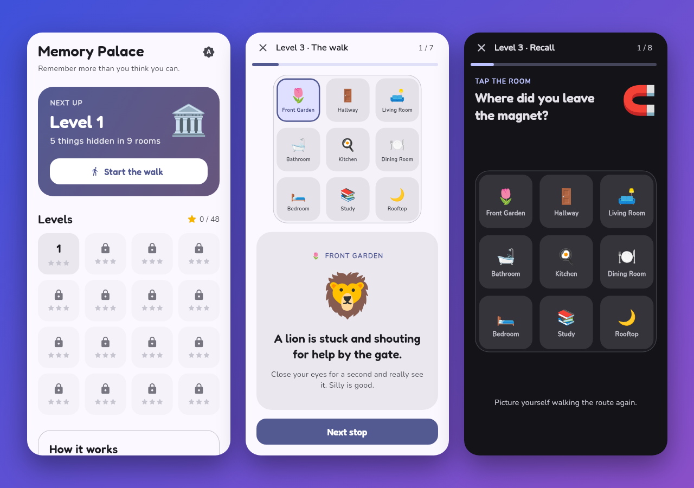

<h1 align="center">🏛️ Memory Palace</h1>

<p align="center">
  <b>Remember more than you think you can.</b><br>
  A Flutter game that teaches the <i>method of loci</i>, the technique memory champions use.
</p>

<p align="center">
  <a href="https://play-memory-palace.vercel.app"></a>
  
  
  
</p>

<p align="center">
  <a href="https://play-memory-palace.vercel.app"></a>
</p>

## 🎮 Play

**https://play-memory-palace.vercel.app**

It runs in any browser. On a phone it fills the screen like an app; on a desktop it opens in a phone-sized frame.

## 🧠 How it works

1. **Walk.** Go room by room through a 9-room house, from the Front Garden to the Rooftop. At every stop something strange is happening, like *"A lion is stuck and shouting for help by the gate."*
2. **Picture it.** Imagine each scene in detail: the noise, the size, the mess. Weird pictures stick.
3. **Recall.** Walk the house again in your head and answer:
   - **What was here?** "What was inside the fridge?" Pick from 4 items.
   - **Where was it?** "Where did you leave the giraffe?" Tap the room on the floor plan.
   - **What order?** Tap 4 items in the order you walked past them.

Get 60% right to pass a level, 80% for two stars and 100% for three.

## ✨ Features

- **16 levels**, from 5 items up to 20 (rooms start holding 2–3 items each)
- **Fresh walk every try**: random items, spots and actions, so you can't memorise the answers
- **Floor plan with a live route** that grows as you walk
- **Feedback that teaches**: a wrong answer replays the scene so it sticks next time
- **Results review** of your whole walk, with the stops you missed highlighted
- **Progress saved on device** (unlocked levels, best stars)
- **Light, dark and system themes**
- **Phone-first layout everywhere**, including desktop browsers

## 🛠️ Tech

- **Flutter** with Material 3, no game engine needed
- [`shared_preferences`](https://pub.dev/packages/shared_preferences) for progress
- [`google_fonts`](https://pub.dev/packages/google_fonts) (Fredoka + Nunito)
- Hosted on **Vercel** as a static Flutter web build

```
lib/
├── main.dart              App, themes, phone frame
├── data.dart              Rooms, spots, items, actions
├── game.dart              Level generation, quiz, scoring
├── progress.dart          Saved progress (InheritedNotifier)
├── theme.dart
├── screens/               Home → Study (walk) → Recall → Result
├── widgets/               Floor plan, phone frame, top bar
└── dev/preview_main.dart  Opens any screen directly, for screenshots
```

## 🚀 Run locally

```bash
git clone https://github.com/Prajit7/memory-palace.git
cd memory-palace
flutter pub get
flutter run -d chrome        # or an Android / iOS device
flutter test
```

To try it on your phone over Wi-Fi:

```bash
flutter run -d web-server --web-hostname 0.0.0.0 --web-port 8080
# then open http://<your-computer's-IP>:8080 on the phone
```

## 🌐 Deploy

Vercel doesn't have Flutter installed, so the site is deployed as a prebuilt static build:

```bash
flutter build web --release
cd build/web && vercel deploy --prod
```

## 🗺️ Ideas for next

- **My Own Palace**: name the rooms of your real home and memorise your own lists
- Daily challenge with a shareable result
- Timed mode
- Sound and haptics

---

<p align="center">Made by <a href="https://github.com/Prajit7">Prajit Bhat</a></p>
